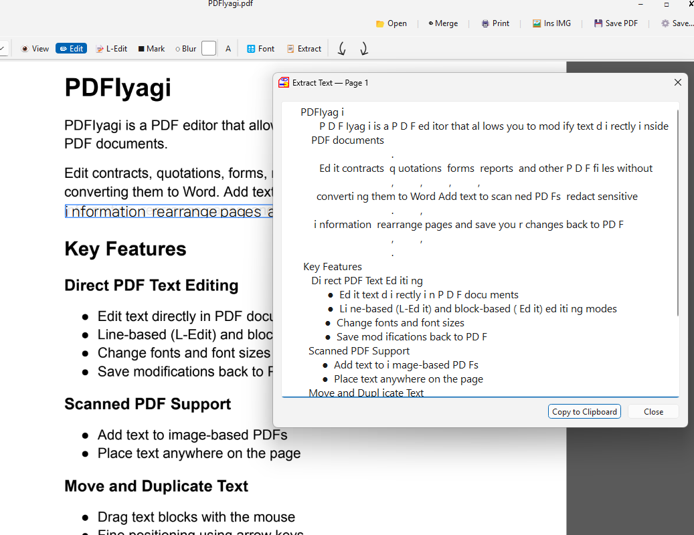
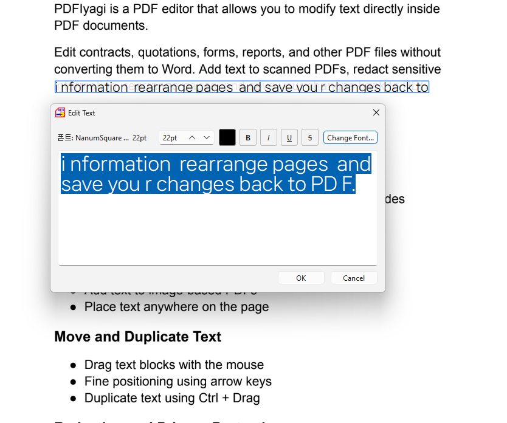
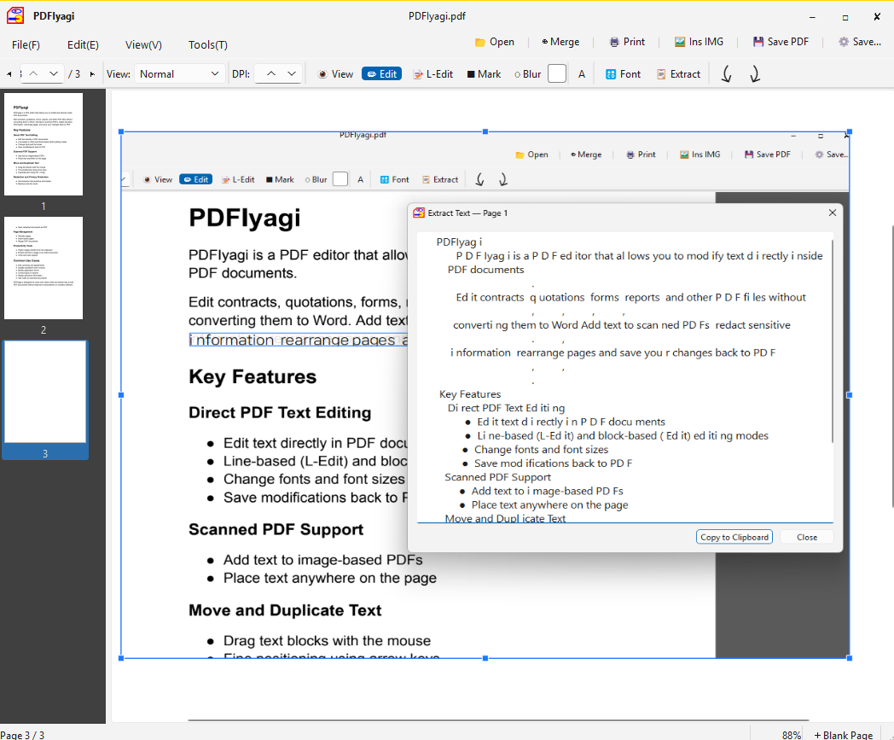

# PDFIyagi

**A PDF editor that edits the text that's already there — plus signatures, stamps, redaction and built-in OCR. Windows and Linux.**

[English](README.md) · [한국어](README_ko.md)



## Why PDFIyagi?

- **Fix the text itself.** Click a line in an existing PDF and type — no white boxes pasted over the old words. Bold, italic, underline, strikethrough and color. Save, reopen, and it's still editable.
- **Sign and stamp in seconds.** Drop in a signature or company seal image, move it anywhere, and move it again later. Paste images straight from the clipboard.
- **Scanned paper becomes searchable.** A neural OCR engine is built in (Korean + English, Chinese + Japanese + English, Western European). No Tesseract, nothing extra to install, under a second per page.
- **Scan straight into the editor.** Works with your scanner, including multi-page auto-feed (ADF), 300–4800 DPI.
- **Hide what must not leak.** Redaction removes sensitive content for good; blur softens an area.
- **Built for AI.** Save as AI7 — a document format that keeps the page, its text, its tables (as CSV) and its structure (as Markdown) together, ready for search and AI tools.

## Features

### Edit
- Edit existing text in line (L-Edit) or field (Edit) mode, with fonts sized to match the original
- Type onto scanned pages and on top of images
- Shapes: rectangle, ellipse, line, arrow — saved as vectors
- Table cells editable one by one

### Pages
- Crop (non-destructive in PDF), rotate, copy and drag pages between two PDFIyagi windows

### Sign · stamp · protect
- Signature and seal images, re-editable after saving
- Redaction and blur

### Scan · OCR
- Scanner support with ADF multi-page scanning
- Built-in neural OCR (PP-OCRv5) — searchable PDF output

### AI7 format
- Page image + text layer + edit layer in one file; tables to CSV, structure to Markdown
- See [AI7 format](AI7FORMAT.md) and [AI7 quick start](AI7_QUICKSTART.md)

| | |
|---|---|
|  |  |

## Download

**[⬇ Latest release](https://github.com/iyagicom/PDFIyagi/releases/latest)**

| Your system | File to pick |
|---|---|
| Windows 10 / 11 | [Microsoft Store](https://apps.microsoft.com/search?query=PDFIyagi) |
| Ubuntu 24.04 · Debian | `.deb` marked **ubuntu24.04** |
| Ubuntu 26.04 | `.deb` marked **ubuntu26.04** |
| Fedora · openSUSE | `.rpm` |
| Arch · Manjaro | `.pkg.tar.zst` |
| Any other Linux | `.AppImage` (run without installing) or `.zip` |

```bash
sudo apt install ./pdfiyagi_*_amd64.deb      # Ubuntu / Debian
sudo dnf install ./pdfiyagi-*.rpm            # Fedora
sudo pacman -U pdfiyagi-*.pkg.tar.zst        # Arch
```

Everything the app needs, OCR models included, is bundled.

## License

[License](LICENSE) · [Privacy policy](privacy-policy.md)
