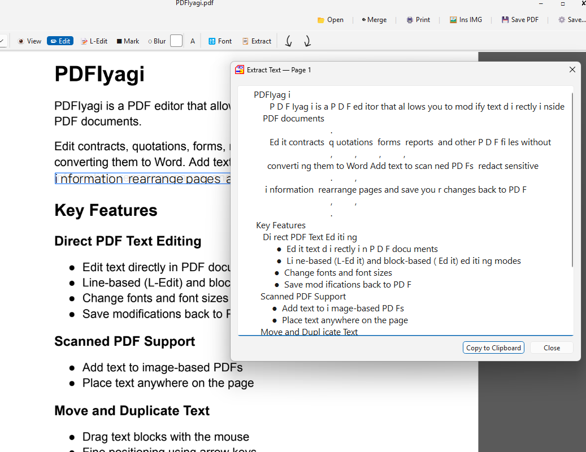
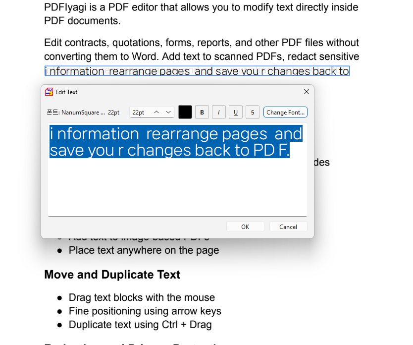
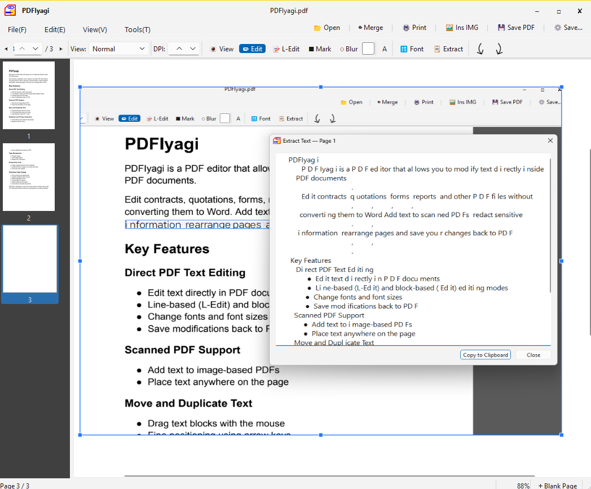

# PDF이야기 (PDFIyagi)

**원래 있던 글자를 그대로 고치는 PDF 편집기 — 서명·도장·가림·OCR 까지. Windows·Linux.**

[English](README.md) · [한국어](README_ko.md)



## 왜 PDF이야기인가

- **글자 자체를 고칩니다.** 기존 PDF 의 줄을 클릭해 바로 타이핑합니다. 흰 상자로 덮고 새로 쓰는 방식이 아닙니다. 굵게·기울임·밑줄·취소선·색상까지. 저장하고 다시 열어도 계속 고칠 수 있습니다.
- **서명·도장이 몇 초.** 서명이나 직인 이미지를 올려 원하는 자리에 두고, 나중에 다시 옮길 수도 있습니다. 복사한 이미지는 바로 붙여 넣습니다.
- **스캔한 종이도 검색됩니다.** 신경망 OCR 이 들어 있습니다(한국어+영어 / 중국어+일본어+영어 / 서유럽어). tesseract 같은 것을 따로 깔 필요 없고, 한 쪽에 1초가 안 걸립니다.
- **스캐너에서 바로 편집기로.** 자동급지(ADF) 여러 장 연속 스캔, 300~4800 DPI.
- **새면 안 되는 정보는 지웁니다.** 정보 삭제 마킹은 내용을 영구히 없애고, 블러는 흐리게 가립니다.
- **AI 를 위한 문서.** AI7 로 저장하면 페이지 그림·글자·표(CSV)·구조(Markdown)가 한 파일에 담겨 검색과 AI 도구에 바로 쓰입니다.

## 기능

### 편집
- 줄 단위(L-Edit)·칸 단위(Edit) 텍스트 편집, 원문 글자 크기 자동 추정
- 스캔 페이지·이미지 위에 글자 입력
- 도형: 사각형·원·직선·화살표 — 벡터로 저장
- 표를 셀 단위로 수정

### 페이지
- 자르기(PDF 는 원본을 건드리지 않는 방식), 회전, 두 창 사이 페이지 복사·끌어다 놓기

### 서명·도장·보안
- 서명·직인 이미지, 저장 후에도 다시 편집
- 정보 삭제 마킹, 블러

### 스캔·OCR
- 스캐너 지원, ADF 여러 장 연속 스캔
- 내장 신경망 OCR(PP-OCRv5) — 검색되는 PDF 로 저장

### AI7 포맷
- 페이지 그림 + 글자 층 + 편집 층을 한 파일에, 표는 CSV, 구조는 Markdown
- [AI7 포맷](AI7FORMAT.md) · [AI7 빠른 시작](AI7_QUICKSTART.md)

| | |
|---|---|
|  |  |

## 다운로드

**[⬇ 최신 버전 받기](https://github.com/iyagicom/PDFIyagi/releases/latest)**

| 내 시스템 | 받을 파일 |
|---|---|
| Windows 10 / 11 | [Microsoft Store](https://apps.microsoft.com/search?query=PDFIyagi) |
| Ubuntu 24.04 · 데비안 | **ubuntu24.04** 가 붙은 `.deb` |
| Ubuntu 26.04 | **ubuntu26.04** 가 붙은 `.deb` |
| 페도라 · openSUSE | `.rpm` |
| 아치 · 만자로 | `.pkg.tar.zst` |
| 그 밖의 리눅스 | `.AppImage`(설치 없이 실행) 또는 `.zip` |

```bash
sudo apt install ./pdfiyagi_*_amd64.deb      # 우분투 / 데비안
sudo dnf install ./pdfiyagi-*.rpm            # 페도라
sudo pacman -U pdfiyagi-*.pkg.tar.zst        # 아치
```

OCR 모델까지 필요한 것은 전부 들어 있습니다.

## 라이선스

[라이선스](LICENSE) · [개인정보 처리방침](privacy-policy.md)
